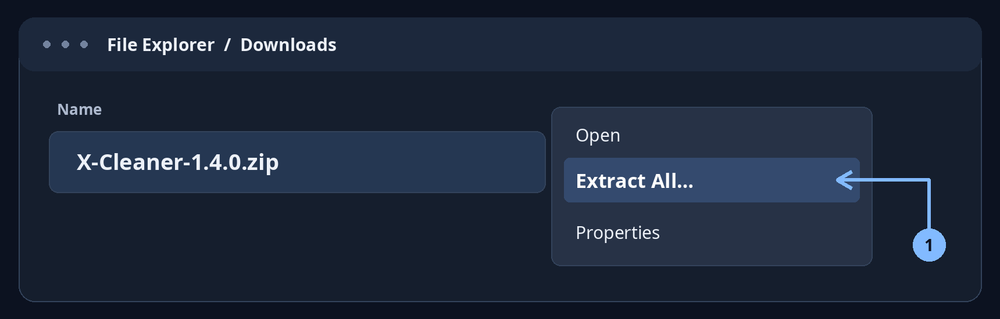
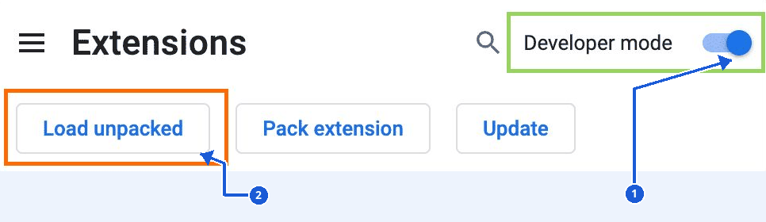
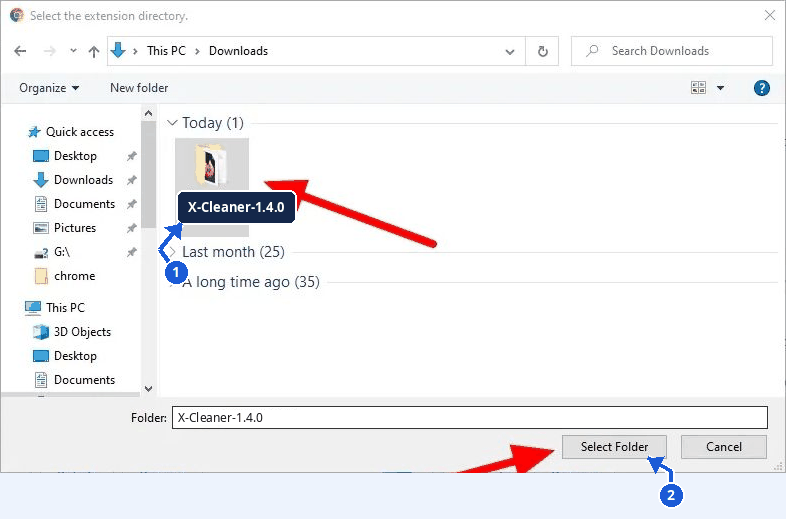
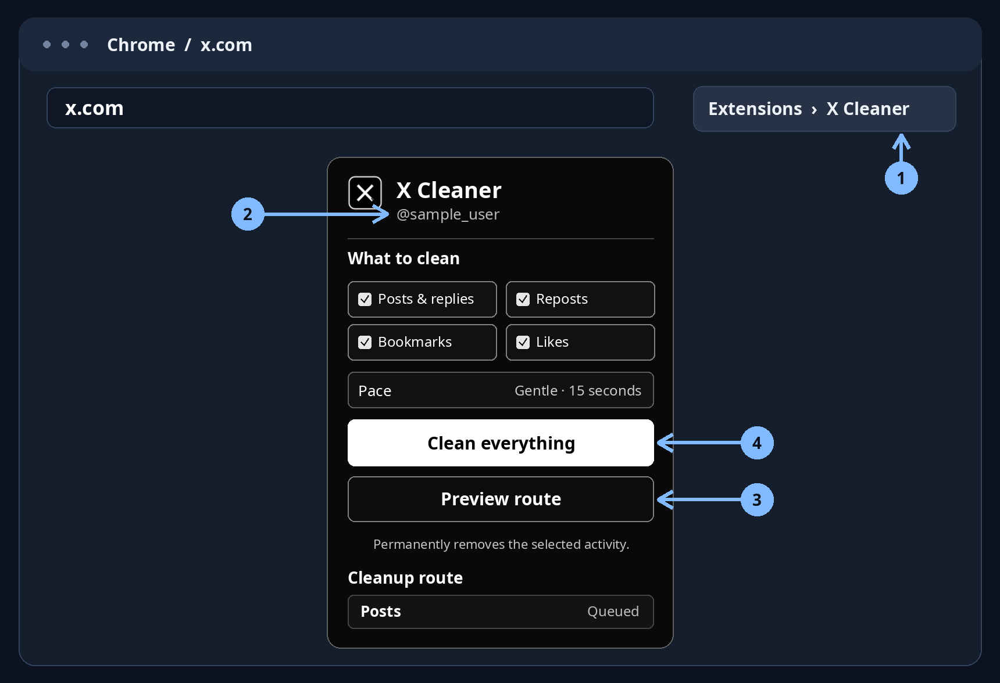

<p align="left">
  <a href="./README.md"></a>
</p>

<div dir="rtl" lang="ar">

# X Cleaner

إضافة لتنظيف منشوراتك وردودك وإعادات نشرك وعلاماتك المرجعية وإعجاباتك على X. تتعرّف على الحساب المسجّل دخوله وتعرض اسم المستخدم قبل بدء التنظيف.

[](./X-Cleaner-1.6.0.zip?raw=true)

**الإصدار 1.6.0 · ملف ZIP · تثبيت يدوي على متصفحات Chromium المكتبية**

## التثبيت والتشغيل

الصور التالية لقطات حقيقية من ويندوز وChrome، أضفت عليها أسهماً وتسميات X Cleaner للتوضيح. الصور تعرض اسم حزمة إصدار سابق. اختر مجلد الإصدار اللي حمّلته. قد يختلف ترتيب الأزرار حسب المتصفح ونظام التشغيل.

### ١. فك ضغط الملف

على ويندوز، اضغط بالزر الأيمن على `X-Cleaner-1.6.0.zip` واختر **استخراج الكل** (**Extract All…**) ثم اضغط **استخراج**. على macOS، انقر مرتين على الملف. على لينكس، استخدم مدير الأرشيف لفك الضغط.



### ٢. فعّل وضع المطوّر

في Chrome، اكتب `chrome://extensions` في شريط العنوان واضغط Enter. فعّل **وضع المطوّر** (**Developer mode**) عند السهم 1، ثم اضغط **تحميل إضافة غير مضغوطة** (**Load unpacked**) عند السهم 2. لعناوين المتصفحات الأخرى، شوف الجدول بالأسفل.



### ٣. اختر المجلد بعد فك الضغط

حدّد مجلد **X-Cleaner-1.6.0** كامل بعد فك الضغط عند السهم 1، ثم اضغط **تحديد المجلد** (**Select Folder**) عند السهم 2. إذا حمّلت الكود من **Code → Download ZIP**، اختر مجلد `extension` الموجود داخل مجلد المستودع بعد فك الضغط.



### ٤. شغّل الإضافة من تبويب X

1. سجّل دخولك في [x.com](https://x.com). من نفس التبويب، اضغط أيقونة **الإضافات** عند السهم 1 واختر **X Cleaner** عند السهم 2. فيك تثبّتها على شريط المتصفح للوصول السريع.
2. تأكّد من اسم حسابك واختر قسماً واحداً أو أكثر. يبدأ المسار بالردود ثم إعادات النشر ثم المنشورات ثم العلامات المرجعية وأخيراً الإعجابات، ويتخطّى الأقسام غير المحدّدة.
3. اضغط **Preview route** للمعاينة بدون حذف.
4. اضغط **Clean selected** أو **Clean everything** لبدء التنظيف. الحذف دائم. خلّي تبويب التنظيف مفتوح، واستخدم **Stop cleanup** إذا بدك توقف العملية.



مصادر اللقطات [Digital Citizen](https://www.digitalcitizen.life/how-unzip-file-windows/) و[Chrome for Developers](https://developer.chrome.com/docs/extensions/get-started/tutorial/hello-world) و[ViewGrip](https://www.viewgrip.net/help/how-to-install-viewgrip-extension-on-chrome).

خانة **Delay between actions** تضبط الفاصل بين العمليات. الافتراضي 15 ثانية، وفِيك تكتب من 0 إلى 3600 ثانية، بما فيها الكسور مثل 0.5. عند 0، تبدأ العملية التالية بعد التحقق من السابقة. تظل استراحة الـ45 ثانية بعد كل ست عمليات والتوقف عند قيود X مفعّلين.

لتحديث الإضافة، فك ضغط النسخة الجديدة فوق مجلد الإضافة اللي ثبّتّه سابقاً، واضغط **Reload** على بطاقة X Cleaner في صفحة الإضافات.

تحدّث الإضافة صفحة التنظيف بعد 10 دقائق على نفس الصفحة، بعد انتهاء العملية الجارية. بعدها تكمّل من نفس القسم وتحافظ على العدّادات وفترة الانتظار. عدّاد **Cards ignored** يحسب بطاقات السياق والعناصر خارج نطاق التنظيف. العناصر المؤهّلة اللي تعثّرت بتنعاد مراجعتها بعد استراحة قصيرة، وإذا استمرت المشكلة بتظهر تحت **Needs review**.

إذا ظهر حدّ طلبات أو تقييد على الحساب من X، تتوقّف الإضافة وتعرض السبب والوقت المنقضي منذ التوقف. يظل التنبيه ظاهر لحد ما تضغط **OK**. بعدها استأنف يدوياً لما يرجع X يشتغل. الخمس دقائق بعد حدّ الطلبات هي الحد الأدنى للانتظار اللي تفرضه الإضافة.

## توافق المتصفحات

| المتصفح | مكان التثبيت |
| --- | --- |
| Chrome وChromium | `chrome://extensions` ثم **Developer mode → Load unpacked**. ملف الإضافة يتطلب Chrome 120 أو أحدث. |
| Microsoft Edge | `edge://extensions` ثم **Developer mode → Load unpacked**. |
| Brave | `brave://extensions` ثم **Developer mode → Load unpacked**. |
| Vivaldi | قائمة Vivaldi ثم **Tools → Extensions**، وبعدها **Developer mode → Load unpacked**. |
| Opera وOpera GX | `opera:extensions` ثم **Developer mode → Load unpacked**. |
| Firefox وSafari ومتصفحات الجوال | ملف ZIP مخصّص لمتصفحات Chromium المكتبية. هذه المتصفحات خارج نطاق الإصدار الحالي. |

حزمة التثبيت مخصّصة لمتصفحات Chromium المكتبية. توافق الإضافة مع كل متصفح وإصدار في القائمة لم يُختبر على حدة. Firefox يتطلّب إعداداً مختلفاً لعمل الإضافة بالخلفية في Manifest V3، وSafari يتطلّب تغليفاً خاصاً. راجع وثائق [Chrome](https://developer.chrome.com/docs/extensions/get-started/tutorial/hello-world) و[Edge](https://learn.microsoft.com/en-us/microsoft-edge/extensions/getting-started/extension-sideloading) و[Brave](https://support.brave.app/hc/en-us/articles/360017909112-How-can-I-add-extensions-to-Brave) و[Vivaldi](https://help.vivaldi.com/desktop/appearance-customization/extensions/) و[Opera](https://help.opera.com/en/extensions/testing/) و[Firefox](https://developer.mozilla.org/en-US/docs/Mozilla/Add-ons/WebExtensions/manifest.json/background) و[Safari](https://developer.apple.com/safari/extensions/).

## حل المشاكل الشائعة

- **ملف manifest غير موجود أو غير قابل للقراءة** — افتح المجلد في مدير الملفات وتأكّد أن `manifest.json` موجود مباشرةً داخله، ثم اختر المجلد نفسه.
- **الحساب غير ظاهر** — سجّل دخولك في `x.com`، حدّث الصفحة وافتح X Cleaner من نفس التبويب.
- **التنظيف توقّف مؤقتاً** — اقرأ السبب في واجهة الإضافة. طلب تسجيل الدخول أو تبديل الحساب أو بلوغ حدّ الطلبات ممكن يوقف العملية مؤقتاً.

## الخصوصية والقيود

تقرأ الإضافة اسم المستخدم من الصفحة وتحفظ تقدم العملية ونتائجها محلياً في المتصفح. ما بتجمع بيانات الدخول أو ملفات تعريف الارتباط أو بيانات التحليلات، وما بترسل تقارير لخدمات خارجية. التنظيف يشمل العناصر التي يعرضها X في واجهته. [قواعد الأتمتة على X](https://help.x.com/en/rules-and-policies/x-automation) تحظر الأتمتة خارج واجهة API، وقد تفرض المنصة قيوداً على الحساب.

## الاختبارات

من جذر المستودع، شغّل الاختبارات باستخدام Node.js. الاختبارات تحاكي صفحات X وواجهات برمجة إضافات المتصفح.

```sh
node tests/test-worker.cjs
node tests/test-content.cjs
node tests/test-popup.cjs
```

</div>
