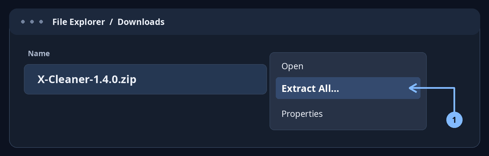
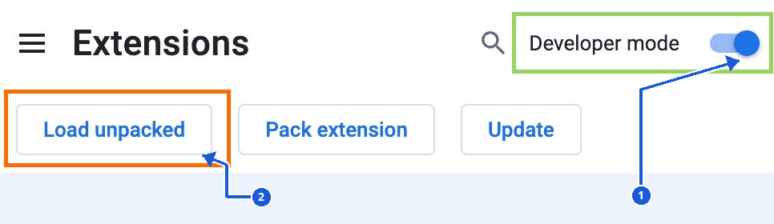
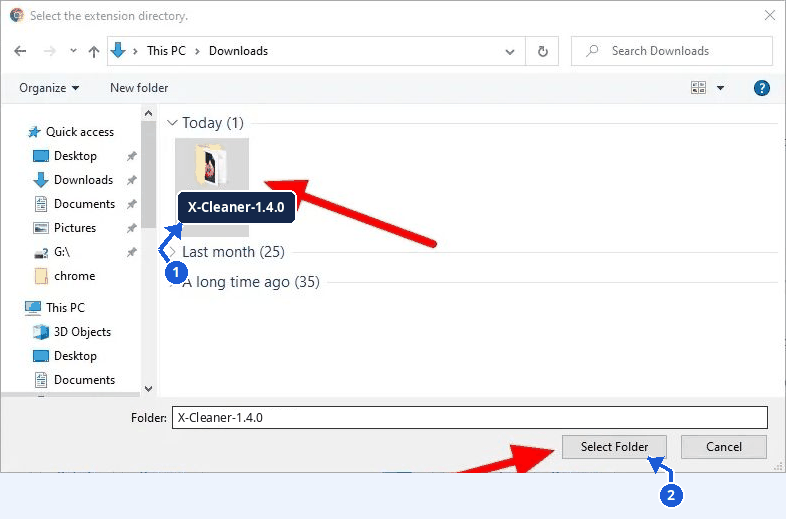
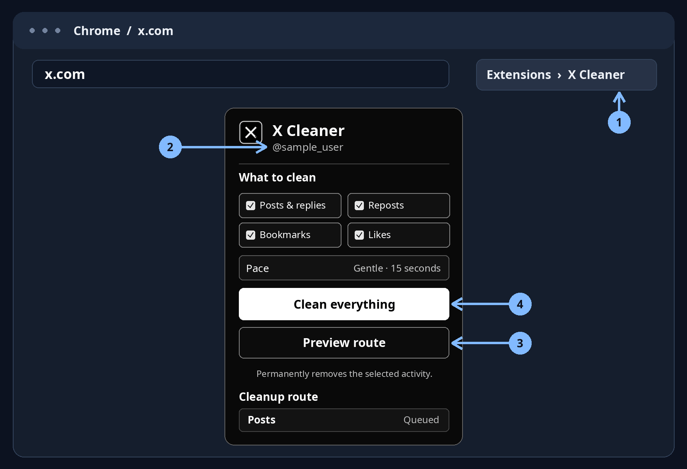

  

# X Cleaner

تنظيف منشوراتك وإعادات نشرك وردودك وعلاماتك المرجعية وإعجاباتك على X بزر واحد.

**1.7.2 · إضافة لمتصفحات Chromium المكتبية**

1. حمّل ZIP وفك الضغط باستخدام **استخراج الكل**.
2. افتح صفحة **الإضافات** (في Chrome هي `chrome://extensions`) وفعّل **Developer mode**.
3. اضغط **Load unpacked** واختر مجلد **X-Cleaner-1.7.2** المستخرج كاملاً.
4. سجّل دخولك في [x.com](https://x.com)، وافتح **X Cleaner**، وتأكد من حسابك، ثم اضغط **Clean everything**.

الترتيب هو **المنشورات ← إعادات النشر ← الردود ← العلامات المرجعية ← الإعجابات**. أزل التحديد عن أي قسم تريد الاحتفاظ به. **Automatic** يضبط الانتظار حسب استجابة X. خلّي تبويب التنظيف مفتوحاً. نفس الزر يوقف العملية أو يستأنفها.

عند فشل التحميل، تعيد الأداة المحاولة وتجرّب مساراً بديلاً. الأقسام المتعذّرة تبقى تحت **Details** للمراجعة، وتكمل البقية. **Retry cleanup** يعيد فحصها. تقييدات X الصريحة توقف العملية وتحتاج إقرار التنبيه.

**للتحديث** فك الحزمة الجديدة فوق مجلد الإضافة الحالي، واضغط **Reload** على بطاقتها بصفحة الإضافات، ثم حدّث تبويب X.

**المتصفحات** · Chrome/Chromium 120+ وEdge وBrave وVivaldi وOpera المكتبية. توافق كل متصفح Chromium لم يُختبر على حدة. Firefox وSafari والجوال تحتاج نسخاً منفصلة.

التقدم محفوظ بمتصفحك. الحذف دائم، والتنظيف يشمل ما يعرضه X. أتمتة الموقع قد تؤدي لتقييد الحساب، وأي تأخير ما بيضمن تجنّب الحظر. [قواعد X](https://help.x.com/en/rules-and-policies/x-automation)

صور التثبيت

لقطات من واجهات ويندوز وChrome الفعلية مع أسهم وتسميات مضافة. أسماء المجلدات بالصور من إصدار سابق.

مصادر اللقطات [Digital Citizen](https://www.digitalcitizen.life/how-unzip-file-windows/) و[Chrome for Developers](https://developer.chrome.com/docs/extensions/get-started/tutorial/hello-world) و[ViewGrip](https://www.viewgrip.net/help/how-to-install-viewgrip-extension-on-chrome).

