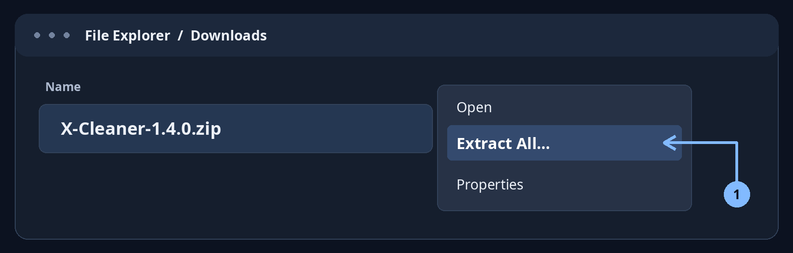
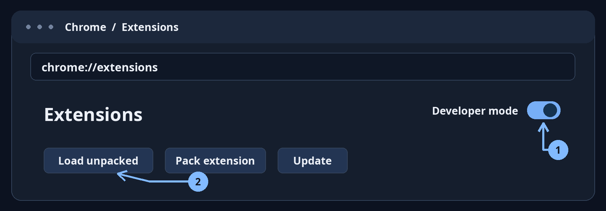
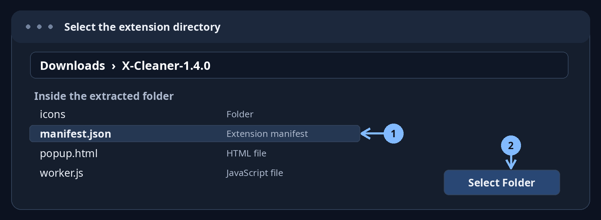
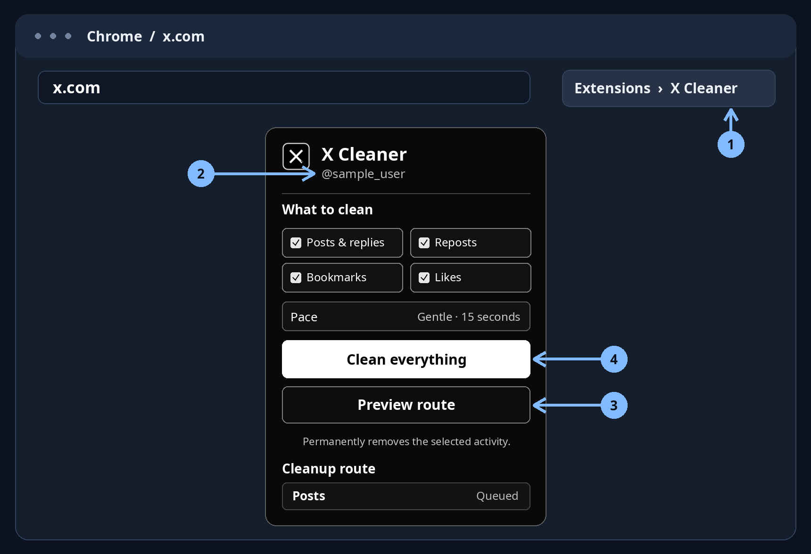

<p align="right">
  <a href="./README.ar.md"></a>
</p>

# X Cleaner

Clean up your own posts, replies, reposts, bookmarks, and likes on X. The extension detects the signed-in account and shows its handle before you start.

[](./X-Cleaner-1.4.0.zip?raw=true)

**Version 1.4.0 · ZIP · Manual installation on desktop Chromium browsers**

## Install and run

The images below are annotated simulations of the Windows and Chrome screens. Interface layout may vary by browser and operating system.

### 1. Extract the ZIP

On Windows, right-click `X-Cleaner-1.4.0.zip`, choose **Extract All…**, then click **Extract**. On macOS, double-click the ZIP. On Linux, use your archive manager to extract it.



### 2. Turn on Developer mode

Type `chrome://extensions` in Chrome’s address bar and press Enter. Turn on **Developer mode** (1), then click **Load unpacked** (2). For other browsers, use the address in the compatibility table below.



### 3. Select the extracted folder

Open the extracted `X-Cleaner-1.4.0` folder. Check that `manifest.json` is directly inside it (1), then click **Select Folder** (2). The picker may hide individual files. If you downloaded the repository source through **Code → Download ZIP**, select the `extension` folder inside the extracted repository.



### 4. Open X Cleaner on X

1. Sign in at [x.com](https://x.com). On that tab, open **Extensions → X Cleaner** (1). You can pin it for faster access.
2. Check that the displayed handle is yours (2), and select the activity types you want to clean.
3. Choose **Preview route** (3) to scan without removing anything.
4. Choose **Clean selected** or **Clean everything** (4) to remove the selected activity. Deletions are permanent. Keep the cleanup tab open and use **Stop cleanup** if you need to stop the run.



## Browser compatibility

| Browser | Where to install |
| --- | --- |
| Chrome and Chromium | `chrome://extensions` · Developer mode → Load unpacked. The manifest requires Chrome 120 or later. |
| Microsoft Edge | `edge://extensions` · Developer mode → Load unpacked. |
| Brave | `brave://extensions` · Developer mode → Load unpacked. |
| Vivaldi | Vivaldi menu → Tools → Extensions · Developer mode → Load unpacked. |
| Opera and Opera GX | `opera:extensions` · Developer mode → Load unpacked. |
| Firefox, Safari, and mobile browsers | This ZIP targets desktop Chromium. These browsers are outside the scope of this release. |

The ZIP was packaged and validated with Chromium. Compatibility with each listed Chromium browser and version has yet to be tested individually. Firefox uses a different background-script setup for Manifest V3. Safari requires its own packaging. See [Chrome](https://developer.chrome.com/docs/extensions/get-started/tutorial/hello-world), [Edge](https://learn.microsoft.com/en-us/microsoft-edge/extensions/getting-started/extension-sideloading), [Brave](https://support.brave.app/hc/en-us/articles/360017909112-How-can-I-add-extensions-to-Brave), [Vivaldi](https://help.vivaldi.com/desktop/appearance-customization/extensions/), [Opera](https://help.opera.com/en/extensions/testing/), [Firefox](https://developer.mozilla.org/en-US/docs/Mozilla/Add-ons/WebExtensions/manifest.json/background), and [Safari](https://developer.apple.com/safari/extensions/).

## Troubleshooting

- **Manifest missing or unreadable** — Open the folder in your file manager and confirm `manifest.json` is at its top level, then select that folder.
- **Account not detected** — Sign in on `x.com`, reload the tab, and reopen X Cleaner from that tab.
- **Cleanup paused** — Read the reason in the popup. A sign-in prompt, account change, or rate limit can pause the run.

## Privacy and limits

The extension reads the signed-in handle from the page and stores the run and its results locally in the browser. It does not collect credentials, cookies, or analytics, or send reports to a third-party service. The cleaner only works with items X makes available in its interface. X prohibits non-API automation and can restrict accounts under its [automation rules](https://help.x.com/en/rules-and-policies/x-automation).

## Tests

From the repository root, run these tests with Node.js. They simulate X pages and extension APIs.

```sh
node tests/test-worker.cjs
node tests/test-content.cjs
node tests/test-popup.cjs
```
