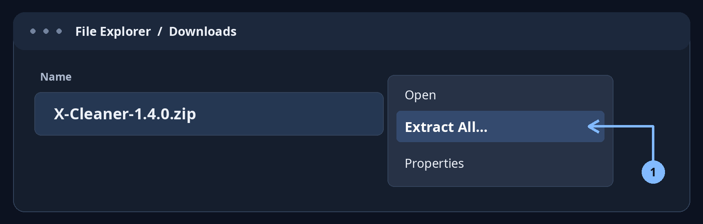
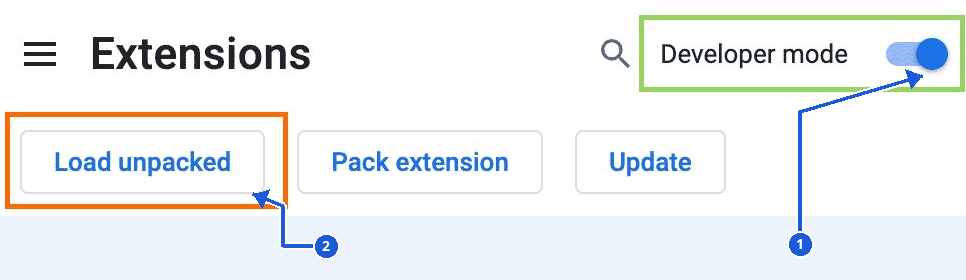
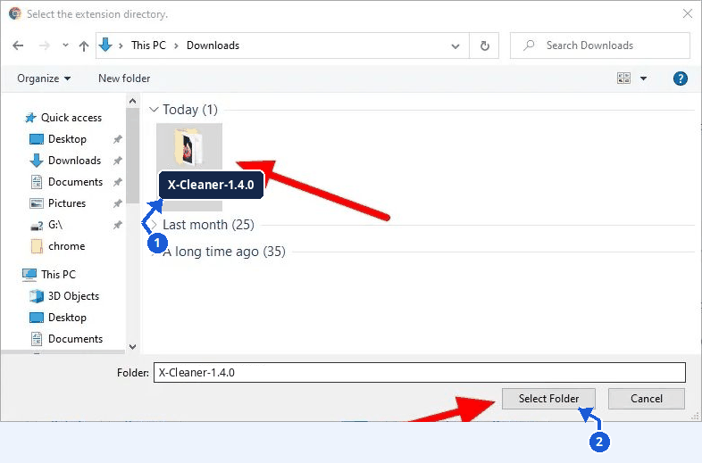
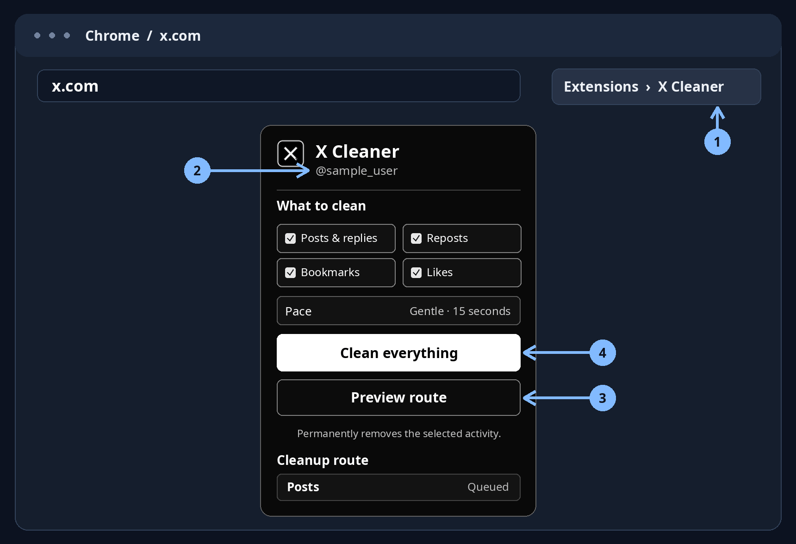

  

# X Cleaner

Remove your X posts, reposts, replies, bookmarks, and likes with one button.

[Download ZIP directly](https://raw.githubusercontent.com/AdnanNaous/X-cleaner/refs/heads/main/X-Cleaner-1.7.4.zip)

**1.7.4 · Desktop Chromium extension**

1. Download the ZIP and **Extract All**.
2. Open **Extensions** (Chrome uses `chrome://extensions`) and turn on **Developer mode**.
3. Click **Load unpacked** and select the entire extracted **X-Cleaner-1.7.4** folder.
4. Sign in at [x.com](https://x.com), open **X Cleaner**, check your account, and click **Clean everything**.

The order is **Posts → Reposts → Replies → Bookmarks → Likes**. Uncheck anything you want to keep. **Automatic** adjusts the wait as X responds. Keep the cleanup tab open. The same button stops or resumes cleanup.

Reposts waits for readable cards or a confirmed empty timeline. Deferred items are rechecked on the same page. If the timeline stops loading, X Cleaner can reload it or try an alternate route. Persistent failures remain under **Activity details** while other sections continue. **Retry cleanup** checks them again. Explicit X restrictions pause the run and require acknowledgement.

**Update** by extracting the new ZIP over your existing extension folder, clicking **Reload** on its extension card, then refreshing your X tab.

**Browsers** · Chrome/Chromium 120+, Edge, Brave, Vivaldi, and Opera desktop. Browser builds have not been tested individually. Firefox, Safari, and mobile need separate builds.

Progress stays in your browser. Deletion is permanent, and cleanup covers items X exposes. Website automation can cause account restrictions. No delay guarantees against enforcement. [X automation rules](https://help.x.com/en/rules-and-policies/x-automation)

Installation pictures

Screenshots use real Windows and Chrome interfaces with added arrows and labels. Folder names show an earlier version.

Adapted from [Digital Citizen](https://www.digitalcitizen.life/how-unzip-file-windows/), [Chrome for Developers](https://developer.chrome.com/docs/extensions/get-started/tutorial/hello-world), and [ViewGrip](https://www.viewgrip.net/help/how-to-install-viewgrip-extension-on-chrome).

